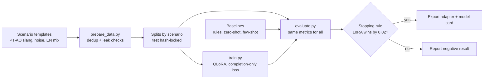

# AdaptLab

**LoRA/QLoRA fine-tuning of a small (0.5B) model done the disciplined way: leak-checked synthetic
data, fair baselines, a test set read only once, and a stopping rule that kills the project if
LoRA doesn't win.**

A fictional telecom operator, **Mukua Telecom**, needs to route customer messages written in Angolan
Portuguese, full of slang, typos and English code-switching, into intents and entities. The
question this project asks is: does a small model with LoRA beat a rules baseline and a prompted
model, at acceptable cost and latency? And will we accept "no" as an answer?

> All data is synthetic. Status: the data pipeline, CPU training dry-run, baselines, demo API, UI
> and Docker image are done and verified. The real GPU training run is **pending** because there's
> no local GPU. The notebook is ready for Colab or Kaggle.

## Highlights

- **A leak-proof dataset.** 688 synthetic examples from 28 scenarios and 56 templates.
  - Splits are by scenario, not by row, with duplicate and near-duplicate detection.
  - The test set is hash-locked.
  - An artificial-leak test proves the detector actually works.
- **Completion-only loss, verified.** A test prints the masked tokens. In the dry-run, 191 prompt
  tokens are masked and 51 carry labels, using the real Qwen2.5 chat template and TRL code path.
- **Fair comparison by design.** The same parsing and metrics apply to rules, zero-shot, few-shot
  and LoRA:
  - macro-F1 with bootstrap CIs,
  - entity F1,
  - valid-JSON rate,
  - high-risk recall,
  - latency and cost.
- **Test-set discipline.** The test split can only be read with `--final`. Each read is logged, and
  a second read needs an explicit, recorded reason.
- **A stopping rule.** If LoRA doesn't beat the best baseline by 0.02 macro-F1 on dev, the publish
  gate blocks the release and the negative result is reported.
- **Serving.** A FastAPI API with a real PEFT mode and a `precomputed_demo` mode that runs without a
  GPU, plus a side-by-side UI comparing the base and adapted models.

## Results so far (dev split)

| Approach | Macro-F1 (intent) | 95% CI | Entity F1 | High-risk recall | Source |
|---|---|---|---|---|---|
| Rules (keywords + regex) | **0.8351** | [0.773, 0.881] | 0.9696 | 0.6275 | full dev set |
| Qwen2.5-0.5B zero-shot (CPU) | 0.1803 | [0.146, 0.210] | 0.5098 | 0.4118 | 60-example stratified sample, exploratory |
| Few-shot (k=5) | `TODO: measure` | | | | |
| QLoRA adapter | `TODO: measure` (needs GPU) | | | | |

**The bar LoRA has to clear is 0.835, not 0.18.** A cheap rules baseline gave a real number early
and keeps the fine-tune honest. The zero-shot model collapses most intents into one class. The confusion matrix is in the run's
`metrics.json`, summarised in [`reports/model_selection.md`](reports/model_selection.md). Every number
traces to a run folder under [`runs/`](runs/).

## Pipeline



## Tech stack

Python 3.12 · PyTorch · Hugging Face transformers, TRL, PEFT and datasets · bitsandbytes (GPU
notebook) · scikit-learn · FastAPI · Pydantic v2 · pytest · Ruff · Docker · GitHub Actions

## Run it locally (CPU)

```powershell
python -m venv .venv
.venv\Scripts\python -m pip install torch==2.15.0 --index-url https://download.pytorch.org/whl/cpu
.venv\Scripts\python -m pip install -e ".[train,eval,serve,dev]"

.venv\Scripts\python scripts\prepare_data.py --check            # generate + validate data, writes nothing
.venv\Scripts\python scripts\train.py --dry-run                 # CPU: tokenisation, loss mask, 2 LoRA steps
.venv\Scripts\python scripts\evaluate.py --approach rules --split dev
.venv\Scripts\python scripts\evaluate.py --report               # reports/evaluation.md
```

**Demo API in Docker** (verified on 2026-11-27: it builds without torch, runs as a non-root user,
and `/health` and `/model-card` return 200):

```powershell
docker build -t adaptlab-api .
docker run -p 127.0.0.1:8000:8000 adaptlab-api
```

**GPU training:** open the pinned notebook in [`notebooks/`](notebooks/) on Colab or Kaggle (T4).

## Quality checks

The same steps run in CI:

```powershell
.venv\Scripts\ruff check adaptlab scripts tests api
.venv\Scripts\python -m pytest tests          # 93 tests, including the artificial leak and the dry-run
```

## Known limitations

- **No GPU run yet:** without the QLoRA numbers, the main question is still open.
- **Second candidate missing:** Qwen2.5-1.5B wasn't measured because its download didn't finish, so
  base-model selection is provisional.
- **Lexicon not reviewed:** the Angolan Portuguese lexicon still needs a native reviewer. The
  tooling and the 40-example sample are ready.

## Documentation

- [`docs/architecture.md`](docs/architecture.md), [`docs/decisions.md`](docs/decisions.md),
  [`docs/case-study.md`](docs/case-study.md), [`data/DATASET_CARD.md`](data/DATASET_CARD.md)
- [`docs/learn/`](docs/learn/) (Portuguese): when to fine-tune, synthetic data and leaks,
  tokenisation and chat templates, completion-only loss, LoRA internals, quantisation and QLoRA,
  hyperparameters, evaluation and baselines, and serving adapters, plus interview questions.
