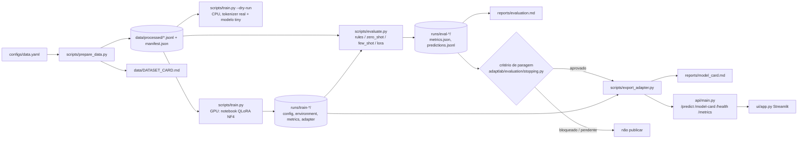

# Arquitectura

## Camadas

| Camada | Módulo | Responsabilidade |
|---|---|---|
| Schema | `adaptlab/schema.py` | Label, parsing defensivo, serialização canónica |
| Dados | `adaptlab/data/` | Catálogo, gerador, validação, deduplicação, splits, fugas, revisão, card |
| Formato | `adaptlab/training/format.py` | System prompt, prompt/completion |
| Treino | `adaptlab/training/` | Config validada, dry-run CPU, treino GPU, tracking, guarda CUDA |
| Avaliação | `adaptlab/evaluation/` | Métricas, bootstrap, baselines, critério, relatório |
| Serviço | `adaptlab/serving/`, `api/` | Predictores real e demo, endpoints, métricas |
| Publicação | `adaptlab/publication/` | Portão de licenças e critério, model card |

## Fronteiras e invariantes

- O **teste** só é lido por `evaluate.py --final`, com hash verificado contra o manifesto.
- O **modo demo** nunca chama um modelo; as respostas trazem `mode: precomputed_demo`.
- O **label** é o mesmo objecto em dados, treino, avaliação e API (`Label`).
- O **base** é sempre o commit fixado em `configs/train.yaml`.
- **Nenhum peso** entra no git (`.gitignore`, `.gitattributes`).
